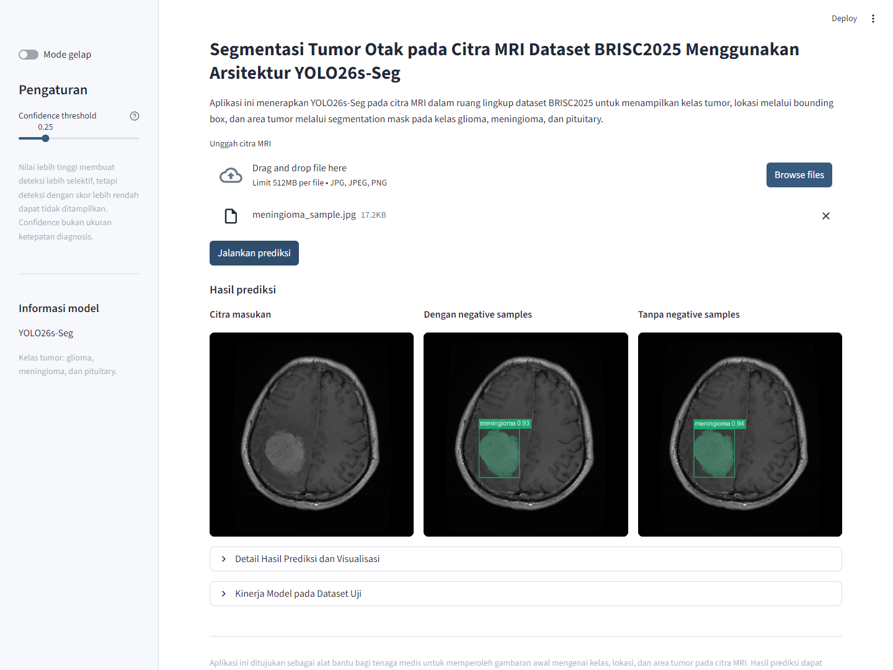

# Segmentasi Tumor Otak pada Citra MRI Dataset BRISC2025 Menggunakan Arsitektur YOLO26s-Seg

**Repositori Pendukung Skripsi | Universitas Sriwijaya**

Aplikasi web berbasis Streamlit untuk menampilkan kelas, lokasi, dan area tumor
pada citra MRI dalam ruang lingkup dataset BRISC2025. Keluaran model ditampilkan
sebagai bounding box dan segmentation mask untuk tiga kelas tumor: **glioma**,
**meningioma**, dan **pituitary**.

Aplikasi memuat dua model YOLO26s-Seg: model yang dilatih dengan negative samples
dan model yang dilatih tanpa negative samples. Satu citra unggahan diproses oleh
kedua model dengan confidence threshold yang sama.



## Fitur Utama

- Unggah citra MRI berformat JPG, JPEG, atau PNG.
- Tampilkan citra masukan dan hasil kedua model dalam satu halaman.
- Perbesar gambar melalui hover atau klik.
- Lihat kelas tumor, confidence, koordinat bounding box, luas mask, dan waktu inferensi.
- Lihat grafik confidence tertinggi dan persentase luas mask per kelas.
- Unduh gambar hasil prediksi dari masing-masing model.
- Buka metrik penelitian melalui bagian **Kinerja Model pada Dataset Uji**.
- Gunakan mode terang atau gelap.

Detail hasil dan grafik berada di bagian lipat **Detail Hasil Prediksi dan
Visualisasi**, sehingga gambar tetap menjadi fokus tampilan.

## Persyaratan

Panduan berikut ditujukan untuk **Windows dengan Python 3.9 64-bit**, sesuai
lingkungan yang telah diuji. Diperlukan Git, koneksi internet saat instalasi awal,
dan browser modern. GPU tidak wajib.

| Komponen | Versi yang Diuji |
| --- | --- |
| Python | 3.9 |
| Streamlit | 1.50.0 |
| Ultralytics | 8.4.126 |
| PyTorch | 2.8.0 |
| Torchvision | 0.23.0 |

Versi dependency utama ditetapkan di [requirements.txt](requirements.txt).
Jangan mengganti versi Ultralytics tanpa menguji ulang kompatibilitas checkpoint.
Penggunaan pada sistem operasi atau versi Python lain belum diverifikasi.

## Instalasi

### 1. Unduh Repositori

Jalankan perintah berikut melalui PowerShell:

```powershell
git clone https://github.com/tzucun/brain-tumor-segmentation-using-yolo26s-seg.git
cd brain-tumor-segmentation-using-yolo26s-seg
```

Repositori bersifat **private**. Akun GitHub yang digunakan untuk clone harus
sudah diberi akses. Memiliki URL repositori saja tidak memberikan akses.

### 2. Buat Virtual Environment

```powershell
py -3.9 -m venv .venv
.\.venv\Scripts\python.exe -m pip install --upgrade pip
```

Perintah selanjutnya menggunakan Python di dalam `.venv` secara langsung,
sehingga tidak perlu mengubah execution policy PowerShell atau mengaktifkan
environment melalui skrip.

### 3. Instal Dependency

Untuk penggunaan CPU, instal PyTorch dan Torchvision terlebih dahulu:

```powershell
.\.venv\Scripts\python.exe -m pip install torch==2.8.0 torchvision==0.23.0 --index-url https://download.pytorch.org/whl/cpu
.\.venv\Scripts\python.exe -m pip install -r requirements.txt
.\.venv\Scripts\python.exe -m pip check
```

Langkah CPU mengikuti [panduan instalasi versi PyTorch](https://pytorch.org/get-started/previous-versions/#v280).
Untuk GPU NVIDIA, ganti perintah instalasi PyTorch CPU dengan build CUDA yang
sesuai dari panduan tersebut. Aplikasi memilih GPU jika CUDA tersedia pada
instalasi PyTorch; jika tidak, aplikasi menggunakan CPU.

Jangan memasang build CPU dan CUDA sekaligus dalam environment yang sama.
Instalasi dependency dapat memerlukan ruang penyimpanan jauh lebih besar
daripada ukuran repositori.

### 4. Jalankan Aplikasi

Pastikan terminal berada di direktori utama repositori, lalu jalankan:

```powershell
.\.venv\Scripts\python.exe -m streamlit run app.py
```

Buka alamat lokal yang ditampilkan Streamlit, biasanya
[http://localhost:8501](http://localhost:8501). Hentikan aplikasi dengan `Ctrl+C`.

Jika port tersebut sedang digunakan:

```powershell
.\.venv\Scripts\python.exe -m streamlit run app.py --server.port 8502
```

## Penggunaan

1. Unggah citra MRI melalui **Unggah citra MRI**.
2. Atur **Confidence threshold** bila diperlukan. Nilai awal adalah `0.25`.
3. Tekan **Jalankan prediksi**.
4. Periksa citra masukan, hasil **Dengan negative samples**, dan hasil **Tanpa negative samples**.
5. Buka **Detail Hasil Prediksi dan Visualisasi** untuk melihat rincian, grafik, dan tombol unduh.
6. Buka **Kinerja Model pada Dataset Uji** jika memerlukan informasi metrik penelitian.

Citra contoh untuk memeriksa fungsi aplikasi tersedia di
[samples/test_images](samples/test_images). Unggah berkasnya melalui aplikasi;
tidak ada pemilih sampel atau fitur evaluasi dataset ZIP di antarmuka.

Perubahan citra atau confidence memerlukan penekanan tombol prediksi kembali.
Membuka gambar, membuka bagian lipat, mengunduh hasil, dan mengganti tema tidak
menjalankan inferensi ulang.

## Model dan Berkas Penelitian

| Model | Checkpoint |
| --- | --- |
| Dengan negative samples | `models/best.pt` |
| Tanpa negative samples | `YOLO26s_seg/02_hasil_training/YOLO26s_seg_tanpa_no_tumor/weights/best.pt` |

Kedua checkpoint disertakan di repositori. Jangan mengubah nama atau struktur
direktorinya tanpa menyesuaikan konfigurasi pada `inference.py`.

Negative samples adalah citra `no_tumor` dengan label kosong saat pelatihan.
**`no_tumor` bukan kelas tumor keempat.** Tidak adanya deteksi pada citra unggahan
juga tidak boleh langsung diartikan sebagai diagnosis tidak ada tumor.

CSV metrik untuk bagian kinerja model berada di:

- `YOLO26s_seg/03_hasil_evaluasi/`
- `YOLO26s_seg/02_hasil_training/YOLO26s_seg_tanpa_no_tumor/03_hasil_evaluasi/`

Dataset penuh, arsip ZIP, hasil training lengkap, bobot duplikat, catatan penelitian
lokal, environment Python, dan secrets tidak disertakan.

## Interpretasi Hasil

**Confidence threshold** menentukan batas skor deteksi yang ditampilkan. Nilai
lebih tinggi membuat hasil lebih selektif, tetapi dapat menghilangkan deteksi
yang benar dengan skor lebih rendah. Confidence bukan ketepatan diagnosis, dan
nilai awal `0.25` bukan klaim hasil tuning terbaik.

**Luas mask** merupakan proporsi area segmentasi terhadap luas citra MRI 2D,
bukan volume tumor. Grafik citra unggahan merangkum keluaran model; grafik
tersebut bukan precision, recall, atau mAP karena unggahan tidak memiliki ground truth.

Kedua checkpoint menggunakan inferensi **end-to-end tanpa NMS**, sehingga
aplikasi tidak menyediakan slider IoU NMS. IoU evaluasi tetap digunakan untuk
menghitung metrik penelitian: mAP50 pada IoU 0.50 dan mAP50-95 pada rentang
IoU 0.50 sampai 0.95. Pengaturan confidence untuk citra unggahan tidak mengubah
metrik penelitian yang dibaca dari CSV.

## Struktur Repositori

```text
.
|-- app.py                  # Antarmuka Streamlit
|-- inference.py            # Pemuatan model, inferensi, dan anotasi
|-- charts.py               # Grafik hasil
|-- comparison.py           # Pengolahan ringkasan hasil model
|-- utils.py                # Pembacaan dan ekspor citra
|-- tune_thresholds.py      # Skrip eksperimen penelitian, terpisah dari antarmuka
|-- requirements.txt
|-- .gitignore
|-- .streamlit/config.toml
|-- assets/                 # Dokumentasi tampilan aplikasi
|-- models/best.pt          # Checkpoint dengan negative samples
|-- YOLO26s_seg/            # Checkpoint kedua dan CSV metrik yang diperlukan
|-- samples/test_images/    # Citra contoh untuk uji fungsi
|-- tests/
`-- README.md
```

## Pengujian

Jalankan pengujian unit dari direktori utama repositori:

```powershell
.\.venv\Scripts\python.exe -m unittest discover -s tests -v
```

Pengujian mencakup tampilan awal, bagian lipat hasil, pemrosesan dua model,
format tabel, penanganan kegagalan, pengolahan data grafik, dan logika eksperimen.
Sebagian pengujian memakai objek tiruan, sehingga tidak menggantikan evaluasi
model pada dataset berlabel.

Pengujian unit dan prediksi kedua checkpoint telah diperiksa pada salinan bersih
berkas repositori dengan dependency yang sudah tersedia di lingkungan pengembangan.
Instalasi dari nol pada komputer lain belum diverifikasi.

`tests/browser_smoke.cjs` adalah pengujian browser opsional. Skrip tersebut
memerlukan Node.js, Playwright, dan Google Chrome pada Windows; ketiganya tidak
diperlukan untuk menjalankan aplikasi sehari-hari.

## Pemecahan Masalah

| Kendala | Pemeriksaan |
| --- | --- |
| Modul tidak ditemukan setelah instalasi | Jalankan instalasi dan Streamlit menggunakan `.venv\\Scripts\\python.exe` yang sama. |
| Versi Ultralytics tidak sesuai | Instal kembali `requirements.txt` pada environment yang digunakan aplikasi. |
| Bobot atau metrik tidak ditemukan | Pastikan kedua checkpoint dan CSV ikut terunduh serta struktur direktorinya tidak berubah. |
| GPU tidak terdeteksi | Periksa dukungan CUDA pada driver dan build PyTorch; aplikasi tetap dapat berjalan dengan CPU. |
| Tidak ada deteksi | Periksa format citra dan confidence threshold. Hasil ini bukan konfirmasi klinis tidak ada tumor. |
| Clone repositori menghasilkan 404 atau akses ditolak | Pastikan sudah login ke akun GitHub yang diberi akses ke repositori private. |

## Batasan Penggunaan

Aplikasi ini dikembangkan sebagai perangkat pendukung skripsi di Universitas
Sriwijaya dan ditujukan untuk membantu tenaga medis memperoleh gambaran awal
mengenai kelas, lokasi, dan area tumor pada citra MRI.

Hasil prediksi dapat mendukung proses diagnosis awal, tetapi **tidak menggantikan
pemeriksaan klinis dan penetapan diagnosis oleh tenaga medis**. Kinerja di luar
ruang lingkup dataset penelitian belum dinyatakan tervalidasi. Gunakan data yang
memiliki izin penggunaan dan jangan mengunggah informasi pasien yang dapat
diidentifikasi.
